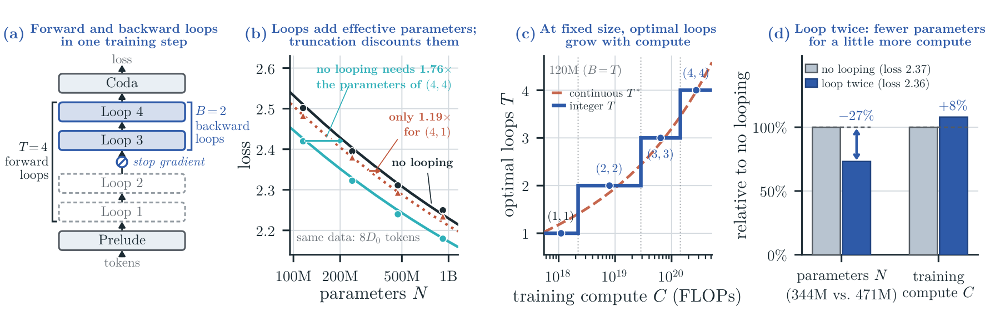

<div align="center">

# Truncate or Not?

### A Scaling Study of Looped Transformers<br>with Truncated Backpropagation

Xuyuan Xiong<sup>1*</sup>, Siyu Chen<sup>2*</sup>, Zihan Shao<sup>2</sup>, Yue Su<sup>1</sup>, Weiyang Jin<sup>1</sup>,<br>
Ping Luo<sup>1</sup>, Zhuoran Yang<sup>2†</sup>, Xihui Liu<sup>1†</sup>

<sup>1</sup>MMLab@HKU · <sup>2</sup>Yale University<br>
<sub>* Equal contribution. † Corresponding authors.</sub>

**[Project Page](https://xjxyys.github.io/truncate-or-not/) · [Paper](https://xjxyys.github.io/truncate-or-not/static/paper.pdf) · arXiv (coming soon)**

**Megatron-LM training and evaluation code for looped transformers with full and truncated BPTT.**

</div>

## Overview

**Truncate backpropagation through the loops only when the number of forward loops is fixed in advance.**

Looped transformers reuse a shared block of layers for $T$ forward loops. Truncated backpropagation through time (BPTT) trains only the last $B \le T$ loops to save compute; full BPTT trains all of them ($B = T$). We vary model size, training tokens, $T$ and $B$ independently and fit one scaling law in which loops add **effective parameters** and truncation discounts them.

<p align="center">
  
</p>

- **Loops add effective parameters; truncation discounts them.** Each fully trained loop adds effective parameters, with diminishing returns; from the same setting, doubling $B$ adds more than doubling $T$.
- **Truncate only when the forward-loop count is prescribed.** At a fixed $T$, truncated BPTT frees compute for a larger model and more data. When both loop counts can be chosen, full BPTT through fewer loops wins at the same compute.
- **At fixed model size, spend additional compute mostly on training tokens.** The best number of fully trained loops grows only slowly with compute.
- **Two fully trained loops are competitive with fewer parameters.** A model with two fully trained loops nearly matches the compute-optimal non-looped model at equal compute; with 8% more compute, it reaches a lower loss with 27% fewer non-embedding parameters.

## Install

Training requires Linux and NVIDIA GPUs. The experiments ran in NVIDIA's PyTorch 25.02 container (Python 3.12, PyTorch 2.7, Transformer Engine) on nodes with 8 GPUs. Execute all commands from the repository root.

```bash
pip install -e '.[monitoring,dev]'
git clone https://github.com/NVIDIA/Megatron-LM.git ../Megatron-LM
git -C ../Megatron-LM checkout ed6ac270ba
python -m pytest tests    # CPU unit tests
```

Megatron-LM is used as a source checkout at `../Megatron-LM` (override with `MEGATRON_LM_PATH`). Data and outputs default to `data/` and `output/`; change them with `DATA_ROOT` and `OUTPUT_ROOT` in `.env` (see `.env.example`).

```text
src/looptf/model/      looped transformer (plain PyTorch)
src/looptf/optim/      MuonH for matrices, AdamW for embeddings, output layer and norms
src/looptf/recipe.py   learning-rate transfer across width, tokens and batch; schedules
src/looptf/scaling.py  model sizes, per-budget settings and compute accounting of the scaling grid
src/looptf/data/       FineWeb-Edu tokenized while training; held-out sets
src/looptf/megatron/   Megatron-LM trainer
scripts/               train.py, prepare_data.py, eval_heldout.py, model_sizes.py
```

## Prepare data

All runs train on the pre-shuffled FineWeb-Edu release [`karpathy/fineweb-edu-100b-shuffle`](https://huggingface.co/datasets/karpathy/fineweb-edu-100b-shuffle), tokenized on the fly with the Llama-2 tokenizer. Its last two shards are held out for evaluation.

```bash
hf download karpathy/fineweb-edu-100b-shuffle --repo-type dataset \
  --revision 4c8f30d6756da75362432a4d5569e1b229263b71 --local-dir data/fineweb-edu-100b-shuffle
python scripts/prepare_data.py manifest     # training shards
python scripts/prepare_data.py validation   # 4,096 held-out documents evaluated during training
python scripts/prepare_data.py duplicates   # held-out documents that also occur in the training shards
python scripts/prepare_data.py heldout      # held-out evaluation set
python scripts/prepare_data.py pack         # tokenized evaluation records
```

## Train

`scripts/train.py` trains one configuration with one process per visible GPU and writes checkpoints and logs to `output/runs/<run-name>/`:

```bash
# 240M model, (T, B) = (4, 4), 4 x 2^30 tokens, one node with 8 GPUs
python scripts/train.py --run-name m240_d4_t4b4 --size 240M --loops 4 --backprop-loops 4 --tokens 4
```

`--tokens` sets the batch, length, warmup, evaluation and learning-rate multiplier of the paper's runs, which `python scripts/model_sizes.py` prints for every budget. For truncated BPTT, lower `--backprop-loops` (e.g. `1` for $(4, 1)$); `--untie-loops` gives every loop its own weights. For several nodes, run the same command on each with `--nnodes`, `--node-rank` and `--master-addr`. `python scripts/train.py --help` lists all options.

## Evaluate

```bash
echo m240_d4_t4b4 > runs.txt
python scripts/eval_heldout.py eval --list runs.txt --gpus 8   # final checkpoints
python scripts/eval_heldout.py read --list runs.txt            # held-out loss in nats per token
```

`read` reports the loss on the deduplicated held-out documents, the number used in the paper, together with a check against the validation loss logged during training.

## License and acknowledgments

The code is released under the [MIT License](LICENSE). [`src/looptf/optim/muonh.py`](src/looptf/optim/muonh.py) is adapted from [`kschwethelm/looped-lm-scaling`](https://github.com/kschwethelm/looped-lm-scaling) (MIT); [NOTICE](NOTICE) lists the third-party material. Megatron-LM is used as a separate checkout under its own license. The model, data pipeline and MuonH + HyperP recipe follow [Schwethelm et al. (2026)](https://arxiv.org/abs/2604.21106), and the recurrent-depth design follows [Huginn (Geiping et al., 2025)](https://arxiv.org/abs/2502.05171). We thank the authors for releasing their code.

## Citation

If you find this work useful, please cite:

```bibtex
@misc{xiong2026truncate,
  title  = {{Truncate or Not? A Scaling Study of Looped Transformers with Truncated Backpropagation}},
  author = {Xuyuan Xiong and Siyu Chen and Zihan Shao and Yue Su and Weiyang Jin and Ping Luo and Zhuoran Yang and Xihui Liu},
  year   = {2026}
}
```
